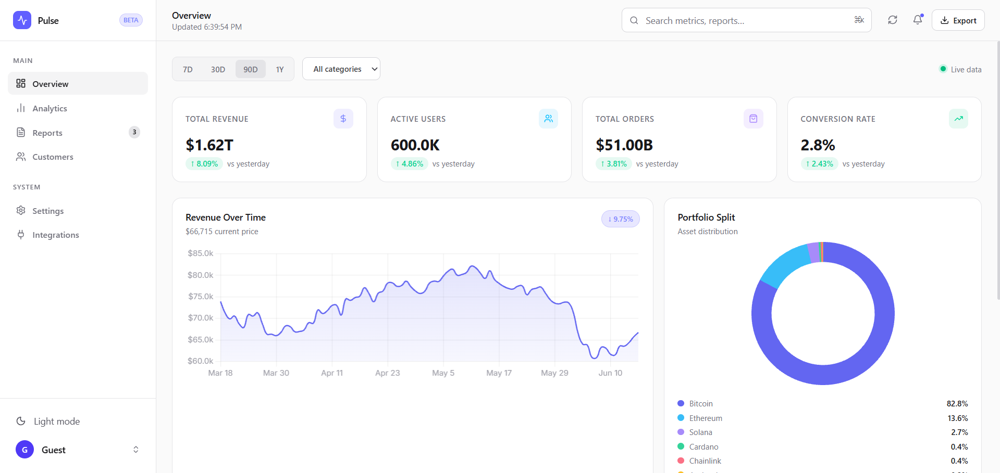
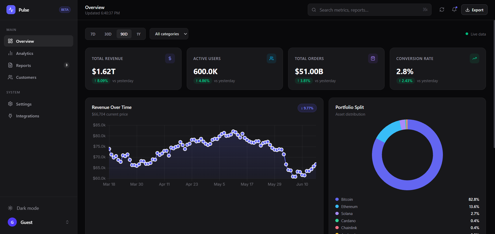
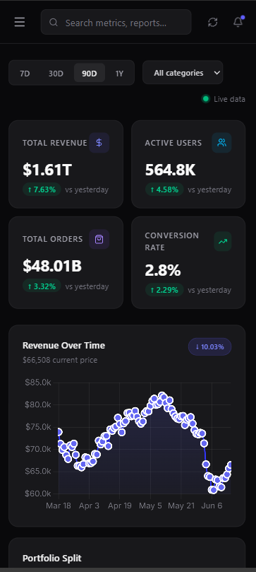

# Analytics Dashboard

An interactive analytics dashboard built with HTML, CSS, JavaScript, Tailwind CSS, and Chart.js.

## Live Demo

https://zee7han0-dev.github.io/Analytics-Dashboard-Portfolio-Project/

## Features

- Responsive dashboard layout
- Sidebar navigation
- Interactive charts
- Analytics overview cards
- Dark / Light mode toggle
- LocalStorage theme persistence
- Real-time crypto market data
- Modern SaaS-inspired UI
- Mobile-friendly design
- Loading and error states

## Tech Stack

- HTML5
- CSS3
- JavaScript (ES6+)
- Chart.js
- CoinGecko API

## Screenshots

### Light Mode

### Dark Mode

### Mobile View

## Development Background

I built this project with AI assistance while learning web development and exploring AI-assisted software development. Although I know the concepts on which the code works.

##n What I learned

Here is what I learned while building this project:
-I learned to 

## Author

Zeeshan
